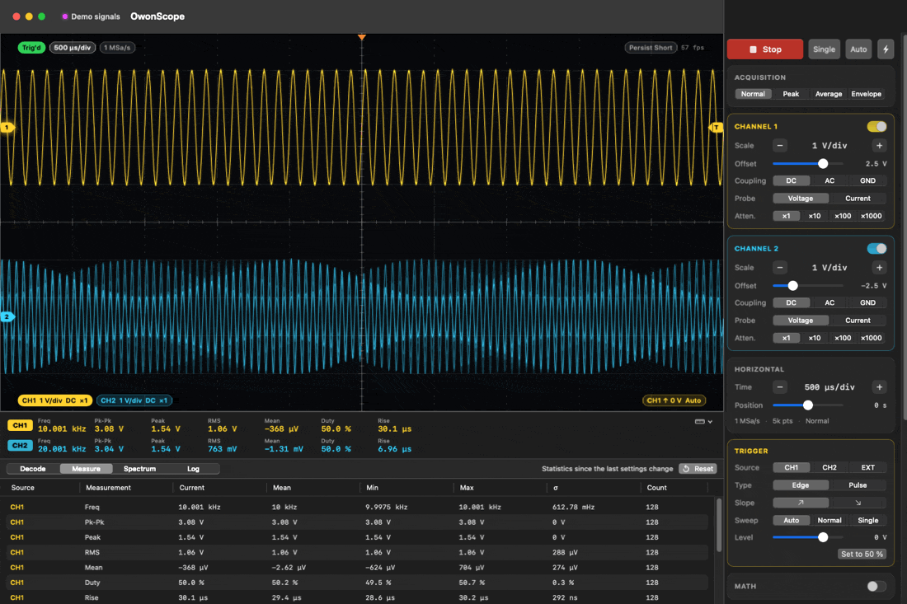
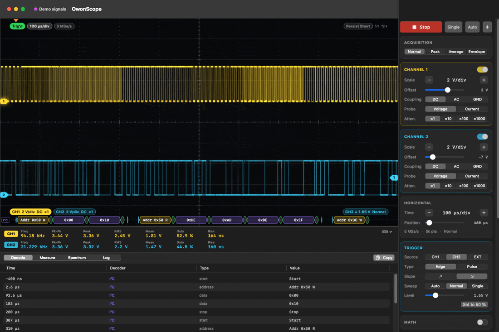
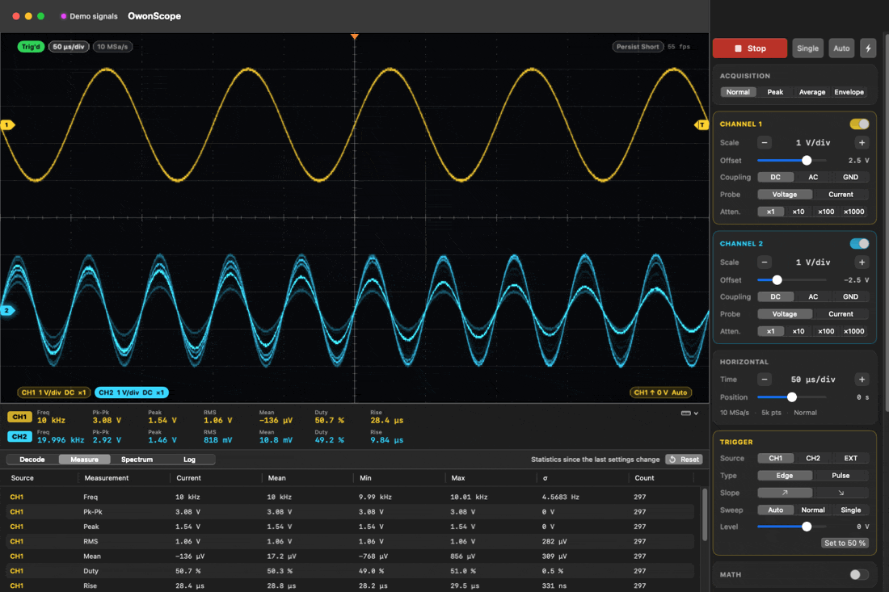
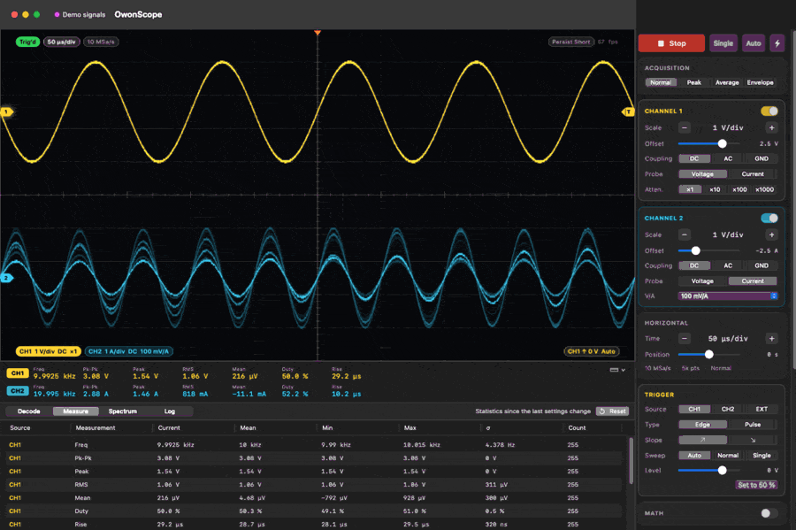
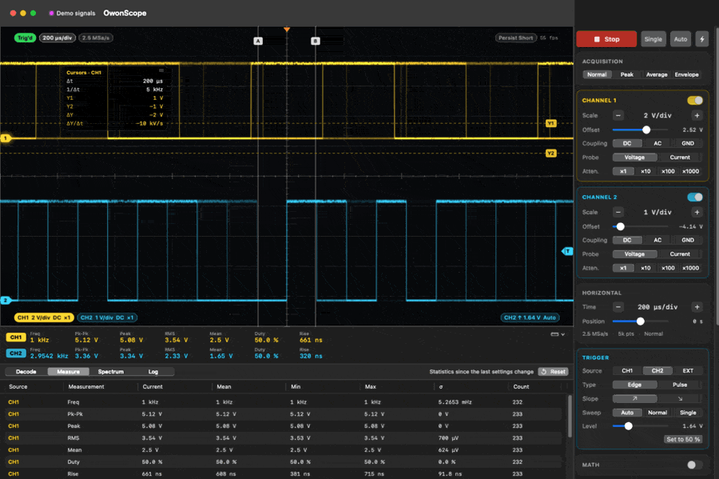
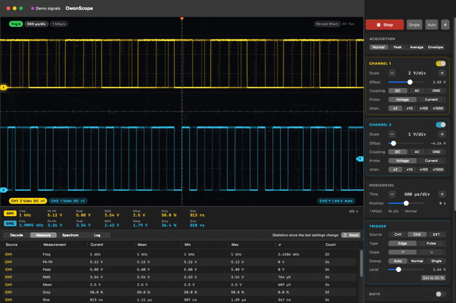
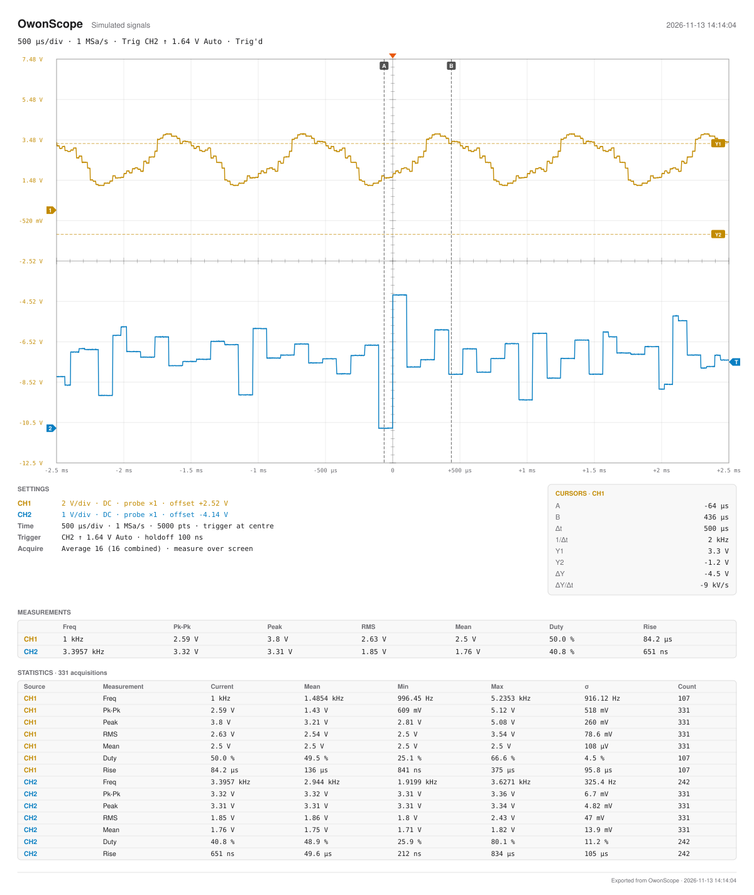

# OwonScope

**A native macOS app for the OWON VDS1022 / VDS1022I USB oscilloscope.** It is written in SwiftUI with a Metal waveform renderer, and it adds protocol decoding, math, averaging, cursors and vector report export.



OwonScope talks to the scope directly over USB through libusb. You don't need Java, Wine or OWON's Windows software, and it runs natively on Apple Silicon and Intel Macs. Every feature shown here also works with the built-in simulator, so you can try it without hardware. The recordings on this page come from the simulator.

## Features

- **Fast, smooth display.** Antialiased traces drawn with Metal at up to 55 fps, with optional phosphor-style persistence.
- **20 ns/div to 100 s/div.** Timebases faster than 5 µs/div are rebuilt from the 100 MS/s samples with windowed sin(x)/x interpolation. Timebases of 500 ms/div and slower use roll mode.
- **Exact trigger alignment.** The edge is found to sub-sample precision, which removes the hardware's sample-rate-dependent trigger offset and jitter. Edge and pulse-width triggers, with holdoff.
- **Protocol decoding:** UART, I²C and SPI, shown as bus lanes on the screen, a table and an ASCII terminal.
- **Acquisition modes:** Normal, Peak detect, Average (2–1024 captures) and Envelope, alongside persistence.
- **Math channel** with derived units, and **current probe** support.
- **Cursors:** time, amplitude, both, or track.
- **29 measurements** with live statistics, CH1→CH2 delay and phase, and gating to the screen or the cursors.
- **FFT spectrum, XY mode, and reference waveforms.**
- **Vector report export** as SVG, PDF or PNG.
- **Direct manipulation:** drag markers, traces and cursors, scroll or pinch to zoom, and click a trace to select it.

### Protocol decoding



| Protocol | What it decodes |
|---|---|
| **UART** | auto baud, 5–9 data bits, parity, inverted (RS-232) input, ASCII terminal |
| **I²C** | address and R/W, data, ACK/NACK, start, repeated start and stop |
| **SPI** | modes 0–3, 8 or 16-bit words, MSB or LSB first. With two channels there's no chip-select, so frames are split on idle gaps. |

Decoded events are shown as lanes over the waveform and in a table you can copy.

### Averaging, envelope and persistence



Only triggered captures are combined. Each one is resampled onto a common time grid using its sub-sample trigger position, so averaging doesn't smear fast edges.

### Math and current probes



- **Math:** A+B, A−B, A×B, A÷B, d/dt, ∫ and −A. Units follow the inputs: V×A is W, V÷A is Ω, and ∫A is C. Auto-scale fits the result, and the M marker can be dragged.
- **Current probes:** set a channel as a current probe from 1 V/A down to 1 mV/A. Scales, offsets, trigger level, cursors and measurements then all read in amps. Voltage probes go from ×1 to ×1000.

### Cursors



Cursor modes are Time, Amplitude, Both and Track. The readout shows Δt, 1/Δt, Y1, Y2, ΔY and slew rate (ΔY/Δt) for the selected trace. Drag the readout wherever it isn't in the way; double-click it to send it home.

### Measurements, statistics, spectrum and XY



| Group | Measurements |
|---|---|
| Horizontal | frequency (from the hardware counter), period, ± width, duty, rise, fall |
| Vertical | Pk-Pk, Peak, max, min, amplitude, top, base, mean, cycle mean, RMS, AC RMS, cycle RMS, crest factor, overshoot, preshoot, area |
| Count | positive and negative pulses, rising and falling edges |
| CH1 → CH2 | delay, phase |

Measure over the whole record, the visible screen, or between the time cursors. The Measure tab keeps statistics for every measurement.

### Vector report export

<picture>
  <source media="(prefers-color-scheme: dark)" srcset="docs/img/report-dark.svg">
  
</picture>

**File → Export Report** (⌘⇧S) redraws the screen from the waveform data as **SVG** (web), **PDF** (reports) or **PNG**, in a light theme for print or a dark theme that matches the screen. The report includes:
- the plot with axis labels, markers, cursors and decode lanes;
- timebase and V/div, plus the full channel, trigger and acquisition settings;
- the cursor readout, the measurements, and optionally the statistics.

**Copy Report** (⌘⇧C) puts it on the clipboard as vector art for Pages, Keynote or Word. The report above was exported straight from the app.

## Requirements

- macOS 14.4 or later. Apple Silicon or Intel.
- Xcode 16 or later, or the Swift 6 toolchain.
- `brew install libusb pkg-config`
- An OWON **VDS1022** or **VDS1022I**, and its FPGA firmware (see below). The simulator works without either.

## Build and run

```sh
git clone https://github.com/devttys1/owonscope.git
cd owonscope
scripts/build-app.sh               # builds build/OwonScope.app (bundles libusb, ad-hoc signed)
open build/OwonScope.app
scripts/build-app.sh --install     # or build and copy to /Applications
swift run OwonScope                # or run straight from source
```

With no scope connected, choose a signal from the **Source** menu in the toolbar: a 1 kHz reference with UART, an I²C bus, SPI, or sine + AM.

## FPGA firmware

At power-on the VDS1022 needs an FPGA bitstream uploaded to it. The bitstreams belong to OWON, so they are **not included**. Get the `VDS1022_FPGAV*.bin` files from OWON's PC software (`fpga/vds1022/`) or from the `fwr/` folder of [florentbr/OWON-VDS1022](https://github.com/florentbr/OWON-VDS1022). Then use **Acquire → Install FPGA Firmware…** and pick the folder.

The app reads the hardware version from the scope's flash and picks the right bitstream. For example, hardware V5.0.1 uses `VDS1022_FPGAV5_*.bin`. It also looks in:
- `~/Library/Application Support/OwonScope/Firmware/`
- the folder named by `$OWON_FIRMWARE_DIR`
- `OwonScope.app/Contents/Resources/Firmware/` (use `scripts/build-app.sh --firmware <dir>`)
- an installed `OWON VDS1022.app`

## Controls

| Action | How |
|---|---|
| Run / Stop | Space, ⌘R, or the Run button |
| Single shot / Force trigger / Autoset | ⌘⇧R / ⌘⇧F / ⌘⇧A |
| Timebase | scroll or pinch on the screen, ←/→, ⌘[ / ⌘] |
| Select trace | click the trace, its label (bottom left) or its marker; 1 / 2 / M |
| Scale of the selected trace | ⌥-scroll, ↑/↓ |
| Offset | drag the trace or its marker, or ⌘-scroll |
| Trigger level / position | drag the T marker on the right / the ▼ marker at the top |
| Cycle cursor mode | ⌘K |
| Export report / copy report | ⌘⇧S / ⌘⇧C |
| Export waveform data (CSV) | ⌘E |

## How it works

```
Sources/
  CLibUSB/      libusb system module (pkg-config)
  ScopeKit/     UI-free core: USB transport, VDS1022 protocol and calibration, FPGA loader,
                settings → register map, acquisition engine, simulator, trigger refinement,
                measurements, averaging and math, FFT, decoders, vector drawing (SVG / PDF)
  OwonScope/    SwiftUI app: Metal trace renderer, overlays, inspector, panels, report export
```

Settings are declarative. `RegisterMap` turns a `ScopeSettings` value into the full list of register writes, and the hardware backend sends only the ones that changed.

The protocol comes from [florentbr/OWON-VDS1022](https://github.com/florentbr/OWON-VDS1022) and was checked against a VDS1022I with hardware V5.0.1. Two corrections to that driver's comments:
- The coupling bits in `SET_CHANNEL` are **0 = AC, 1 = DC**, 2 = GND.
- The hardware trigger point is off by about −11 samples at 100 MS/s and about +3 at 10 MS/s. OwonScope corrects this in software.

## License

[CC BY-NC-SA 4.0](LICENSE). OWON and VDS1022 are trademarks of their owner; this project is not affiliated with OWON.
